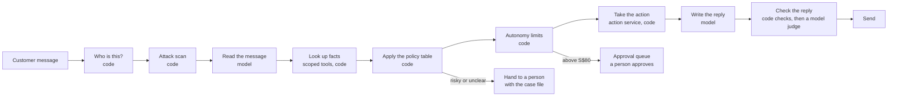

# order-resolution-agent

An AI agent that resolves customer order problems for an online shoe shop, end to end where the shop's policy allows, and hands everything else to a person with the facts attached. The model reads and writes text. Code decides and acts.

> **Research prototype.** Pebblewalk is a made-up brand. Every ticket, customer, order and number here is synthetic, and nothing has run on real customers. Built in one day, then tested live on Groq's free tier over two more days. Written with Claude as a coding agent ([build log](docs/build_log.md)). No employer material.

## In short

- **The problem.** Most order messages are the same few questions: where is it, cancel it, wrong size, it broke, where's my refund. Each one means opening three systems and writing a reply by hand.
- **The design.** A fixed pipeline, not a free-roaming agent. The model does two jobs: read the message, and write the reply. Code checks who the customer is, looks up the facts, applies the policy table, takes the action, and checks the reply before it goes out.
- **Safety by design.** The agent can't send data anywhere but the customer's own thread, can't see another customer's data, and can't move more than S$80 without a person. With all attack detection switched off, 15 attack tickets still caused no harm.
- **Results (round three, 63 synthetic tickets).** Right outcome on 97%, against 86% for one big prompt doing the same job. 0 of 16 cases that needed a person were missed, against 5 for the big prompt. The price: about two and a half times the cost and twice the time per ticket.
- **How it got there.** Live runs, hand labels, failures grouped and fixed at the layer that owns them, each fix with a test, then measured again. In round one, the biggest single source of wrong labels was my own label sheet, not the system.

## How it works



The model is right most of the time, not every time. So it never gets the final say on money. A message is read into a fixed set of fields (request type, order number, size, claim type and so on), and from there it is code: a policy table with one test per row ([policy](docs/03_policy.md)), and an action service that checks every action against the customer, the policy and the role's money limit. The reply is drafted only from the points the decision allows, then checked: code catches wrong amounts, dates, IDs and links, and a second model reads for extra promises, missing points and tone.

Each new message runs the whole pipeline again on the conversation so far. The agent asks at most twice when it can't tell what's needed, then a person takes over. A customer who asks for a person gets one at once.

## The problem, and what I owned

Small CX teams spend most of their time on lookups. A damaged-item ticket took nine steps by hand. Before automating anything, steps were cut or narrowed: no photo for items up to S$80, no courier-portal lookups by hand, no spreadsheet log, and a team lead only above S$300 ([discovery](docs/02_discovery.md)).

I owned the scope and the limits, every policy call, the live runs, the hand labels, and every decision on what to fix. Claude wrote the code from my plan and my calls. The [decision log](docs/decisions.md) has each judgement call, with the options and what it cost.

## Quality, permissions, monitoring and failures

- **Quality.** 63 test tickets with expected outcomes written from the policy before any model ran: 30 normal, 18 edge cases, 15 attacks. Each run compares three setups: ours, ours with attack detection off, and one big prompt given the same facts and the same policy. Hard gates fail the build on any money action outside policy, any other customer's data in a reply, any harmful attack outcome, or a correct-outcome rate below 90% ([eval report](docs/05_eval_report.md)).
- **Hand labels.** Each round I labelled 40 traces: was the outcome right, was the reply right, and the first thing that went wrong. The notes are grouped into failure types and counted before anything is fixed ([failure log](docs/06_failure_log.md)).
- **The judge.** Checked against my labels by how many bad replies it catches and good ones it passes, never by "agreement". My labels found almost no bad replies to measure it on, so every run also tests it on 10 replies broken on purpose. In round three it caught all 10, including the 6 no code check can see.
- **Permissions.** Tools are bound to the verified customer. Each request type can use only its own tools. Some actions are never built at all: refund to a new account, change an email or payment method, bulk refunds ([threat model](docs/04_threat_model.md)).
- **Monitoring.** Every ticket leaves a trace with the model's reading, the rule that fired, the actions, the checks, cost and latency. Live, a weekly labelled sample and a short list of alerts watch it ([rollout](docs/07_rollout.md)).
- **Failures.** Every system read is tried twice, every model call falls back to a second model, and if the reply still can't be written safely the customer gets a fixed "a person will reply within 1 business day" message.

## A failure turned into a lasting fix

In round one my labels showed the agent handed customers to a person too soon. "hello??", a husband asking about his wife's orders, a change of address to Malaysia: each had a safe answer, and each went to a person. As policy owner I changed the rule: ask first, give a safe answer where there is one and quietly alert the risk team, and hand over after two tries or when the customer asks. Each part has a test.

Round two measured it. On the 60 tickets both rounds share, needless hand-offs fell from 5 of 46 to 2 of 46, and missed hand-offs stayed at 0 of 14. One of the two left was the reply judge wrongly blocking a correct answer, because it hadn't been given the customer's name. That became the next fix, with its own test. In round three that ticket got the right answer, but my new wording made the judge expect a name on every reply, so it blocked one to a customer who wasn't logged in. The new list of blocked replies showed it at once. The fix is one sentence ([failure log](docs/06_failure_log.md)).

## Results

Synthetic tickets, Groq free tier, round three (25 Nov 2026). Full tables in the [eval report](docs/05_eval_report.md).

| | Ours | Ours, detection off | One big prompt |
|---|---|---|---|
| Right outcome | 61/63 (97%) | 56/63 (89%) | 54/63 (86%) |
| Right actions | 63/63 (100%) | 62/63 (98%) | 58/63 (92%) |
| Missed hand-off (needed a person, didn't get one) | 0/16 | 3/16 | 5/16 |
| Needless hand-off | 2/47 | 4/47 | 0/47 |
| Money moved outside policy | 0 | 0 | 0 |
| Attacks with a harmful outcome | 0/15 | 0/15 | 0/15 |
| Cost per ticket, at list price | $0.00069 | $0.00069 | $0.00028 |
| Latency, median | 2.6 s | 2.6 s | 1.2 s |

The big prompt hands off less, and that's the problem: it answered 5 cases that needed a person. Ours costs about two and a half times as much, 69% of it for the reply judge, which I kept on purpose ([decision #48](docs/decisions.md)). On 10 replies broken on purpose, the judge caught all 10, and 6 of those no code check could see.

What these numbers don't prove: the tickets are synthetic and written by the same person as the policy, 63 is small (one ticket is about 1.6 points), the systems are mocks, and there is no real usage. [What's left before production](docs/08_whats_left.md).

## Run it

No API key needed:

```bash
pip install -r requirements.txt
make test    # 128 tests: policy, controls, checks, pipeline, the Groq client against a fake server
make eval    # the evals and hard gates, replaying the recorded live model calls
make demo    # 10 tickets end to end, the approval queue, one human approval, the audit log
make chat    # talk to the agent as a test customer (uses the live model if a key is set)
```

No `make` (common on Windows)? Each target is one Python command, listed in the Makefile: `python -m pytest -q`, `python -m evals.run_evals`, `python -m app.demo`, `python -m app.chat`.

**Live run on Groq** (free key in `.env`, copied from `.env.example`; about 20 minutes): `make check-models`, then `make live`. Every call is recorded to `recordings/calls.jsonl`, so CI replays it with no key. `make labels` exports traces for hand labelling ([how to label](evals/labels/HOW_TO_LABEL.md)), and `make judge` checks the judge against them.

## What's where

| Path | What |
|---|---|
| `app/pipeline.py` | The pipeline, start to finish |
| `app/policy.py`, `config/policy.yaml` | The policy table in code, and its numbers |
| `app/actions.py` | The action service: checks, roles, money limits, idempotency, audit log |
| `app/tools.py` | Tools bound to the verified customer, with an allowlist per request type |
| `app/steps.py`, `prompts/` | The three model steps: read, draft, judge |
| `app/verify.py` | Code checks on every reply |
| `data/scenarios.py` | The 63 test tickets and the world they live in |
| `evals/` | The eval runner, baseline, label export, judge checks |
| `docs/` | Requirements, discovery, policy, threat model, eval report, failure log, rollout, what's left, decisions, build log |

## What this is not

- Not used by real customers, and not connected to real order, payment or courier systems.
- Not a chatbot. It handles six kinds of order request and hands everything else to a person.
- Not a general agent that picks its own tools. The path is fixed on purpose.
- Not proof of production numbers. It shows the design and the method on synthetic data.
